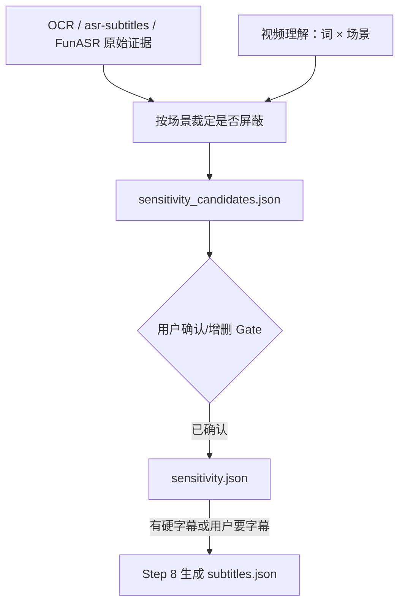

# 大模型进行敏感词检测与屏蔽处理规范

## 第一原则

**禁止生成脚本文件，这部分需要由大模型进行敏感词检测与屏蔽处理**

**用户确认 Gate 是跨回合硬门**：候选敏感词清单必须先给用户看，然后立即结束当前回复。只有用户在**下一条消息**中明确确认（含增删）后，才能写终稿 `sensitivity.json`。用户最初的“处理这个视频”、默认同意、沉默、Agent 自己判定都不算确认；未确认不得调用 erase、ffmpeg、mux、字幕压制或交付工具。

Step 4 的敏感词候选直接吃各路**原始证据**（OCR / asr-subtitles / FunASR / video-understand），先把可能敏感的词扫全，再结合场景裁定；Step 8 才由 [文案校准.md](文案校准.md) 生成 `subtitles.json`。[视频理解佐证.md](视频理解佐证.md) 的 `video-understand-router` 在 probe 确认有音轨后与 separate-voice 并行发起，其场景结论用于对每条候选做「词 × 场景」裁定。不要只按字面黑名单屏蔽。

## 1. 基础信息

### 1.1 输入输出

- 输入证据：
  - OCR 原始文本（有硬字幕时）
  - `asr-subtitles` 句级结果
  - FunASR 词级结果
  - `video-understand-router` 场景结论
- 中间产物：`sensitivity_candidates.json`（候选清单，供用户确认；结构同 `sensitivity.json` 但每条多 `reason` / `scene` 字段）
- 输出文件（**Gate 通过后**才生成）：
  - `sensitivity.json`（敏感词、单字、起止时间，毫秒）
- `subtitles.json` 由 Step 8 [文案校准.md](文案校准.md) 生成：输入有硬字幕时强制生成；无硬字幕时按用户选择生成。
- 时间外扩规则不再固定 ±200ms，改由 [敏感词音频处理.md](敏感词音频处理.md#时长边界按时间戳来源自适应) 按词长自适应（公式以该文件为唯一定义，本文件不复写数值）。本文件的 `sensitivity.json` 只写原始 `[s, e]`，外扩在打哔阶段计算。
- 核心优先级：**场景内是否敏感**。明确脏话 / 色情 / 真实暴力仍须屏蔽；游戏口播、新闻科普等场景里的字面「敏感词」可以不屏蔽。

### 1.2 敏感词定义

需检测并屏蔽的敏感词范围：涉黄、涉毒、暴力、色情、脏话、反恐类词汇（包含谐音、变体等易识别的违规表述）

## 2. 核心原则

- 敏感词要按场景裁定后再屏蔽：
  1. 字幕层：仅对「该场景需要屏蔽」的字换成 `*`；
  2. 音频层：仅对这些区间打哔。
- 检测完整性：候选要扫全，终稿必须结合视频理解的场景结论，禁止只做字面命中。

## 3. 完整处理流程



## 4. 核心操作步骤（可执行）

### 4.1 敏感词候选检测

遍历原始证据，先列出**候选**（字面可能敏感的词），再与视频理解的场景结论对齐：

1. 从 OCR / `asr-subtitles` / FunASR 各自文本中扫出可能敏感的候选词，宁多勿漏；
2. 用视频理解给出的场景（游戏 / 新闻 / 医疗 / 真实暴力 / 色情等）裁定**这条在当前镜头要不要屏蔽**；
3. 仅对「需要屏蔽」的词，优先从 FunASR `words[]` 取 `start` / `end`（秒）；无 FunASR 时退回 `asr-subtitles` 句级窗口内均分插值；
4. 时间按毫秒写入 `sensitivity_candidates.json`，**不做外扩**（外扩留给打哔）；每条附 `reason`（判定理由）与 `scene`（当前场景）。
5. 视频理解尚未返回时，可以先做候选列表，**不要**先定终稿、先打哔。

### 4.2 用户确认 Gate（必做）

把 `sensitivity_candidates.json` 以表格形式呈现给用户：

| #   | 词  | 时间 (s) | 场景 | 判定 | 理由 |
| --- | --- | -------- | ---- | ---- | ---- |

请求用户操作：

- 逐条 **确认 / 移除**；
- 支持 **新增**（用户给出词与大致时间；从 FunASR / `asr-subtitles` 的最近时间窗口补齐）；
- 支持 **批量策略**（如"所有脏话全屏蔽 / 保留"）。

发出候选表和确认问题后，**本回合必须立刻结束**，不得继续调用任何处理工具。候选为空也必须明确展示“未发现候选”，等待用户确认按无敏感词继续。未收到用户下一条消息确认前，不得写 `sensitivity.json`、不得提交字幕擦除、不得启动 ffmpeg、不得合流或交付。

用户确认结果先落盘为 `sensitivity.json`（毫秒）。输入有硬字幕时，后续 Step 8 必须生成 `subtitles.json`（秒，已确认敏感字替换为 `*`）；这不是可选问题。

### 4.3 屏蔽替换逻辑

#### 4.3.1 字幕屏蔽

字幕 `*` 替换在**句级文本上按字符匹配**做，**不依赖字级时间戳**（字级时间戳只用于音频打哔，插值时不准，不能拿来定位要替换的字）：

1. 输入有硬字幕时强制生成 `subtitles.json`；无硬字幕时仅在用户明确要求新字幕时生成。每条句子取句级文本（优先 OCR，其次 asr-subtitles）。
2. 在该句文本里**按字符串定位敏感词**，把命中的敏感字逐字替换为 `*`（例：`活活饿死了` 命中"饿死" → `活活**了`）。一个敏感字对应一个 `*`，字数严格相等，不要多打或少打。
3. 只替换 Gate 1 用户确认过的敏感词；同一个词在句中出现多次要全部替换。
4. 非敏感内容原样保留，标点、语气词不动。

常见错误（务必避免）：

- ❌ 用字级时间戳反推"第几个字"来打 `*` —— 插值不准会错位，把"死"打成旁边的字。**改用字符匹配**。
- ❌ `*` 个数和敏感字数不等（如"傻逼"打成 3 个 `*`）。
- ❌ OCR 文本和 asr 文本不一致时混用 —— 有硬字幕就以 OCR 文本为准，保证屏幕上的字和 `*` 一一对应。

按 [文案校准.md](文案校准.md) 的语义融合结果写出 `subtitles.json`，供 [add-subtitle-to-video](byted-mediakit-editing/reference/add-subtitle-to-video.md) 的 `--subtitles` 使用（不要再生成 ASS，也不要跑 `generate_subtitles.py`）：

```json
[
  {
    "subtitle_text": "活活**了",
    "start_time": 7.8,
    "end_time": 8.48
  }
]
```

`start_time` / `end_time` 单位为**秒**，直接用句级 `[start_time, end_time]`（不是字级）。POSIX / bash 的 `--subtitles` 用单引号整体包裹合法 JSON；Windows PowerShell 必须按 `SKILL.md` 的 JSON 传参规则，将普通参数放在 `--%` 前，并在其后直接内联转义后的完整 JSON，禁止 `$json` 或 `Get-Content`。

`sensitivity.json` 仍用毫秒，格式如下：

```json
[
  {
    "end_time": 8480,
    "start_time": 7800,
    "text": "活活饿死了",
    "is_sensitivity": true,
    "words": [
      {
        "end_time": 7840,
        "start_time": 7800,
        "text": "活"
      }
    ]
  }
]
```
