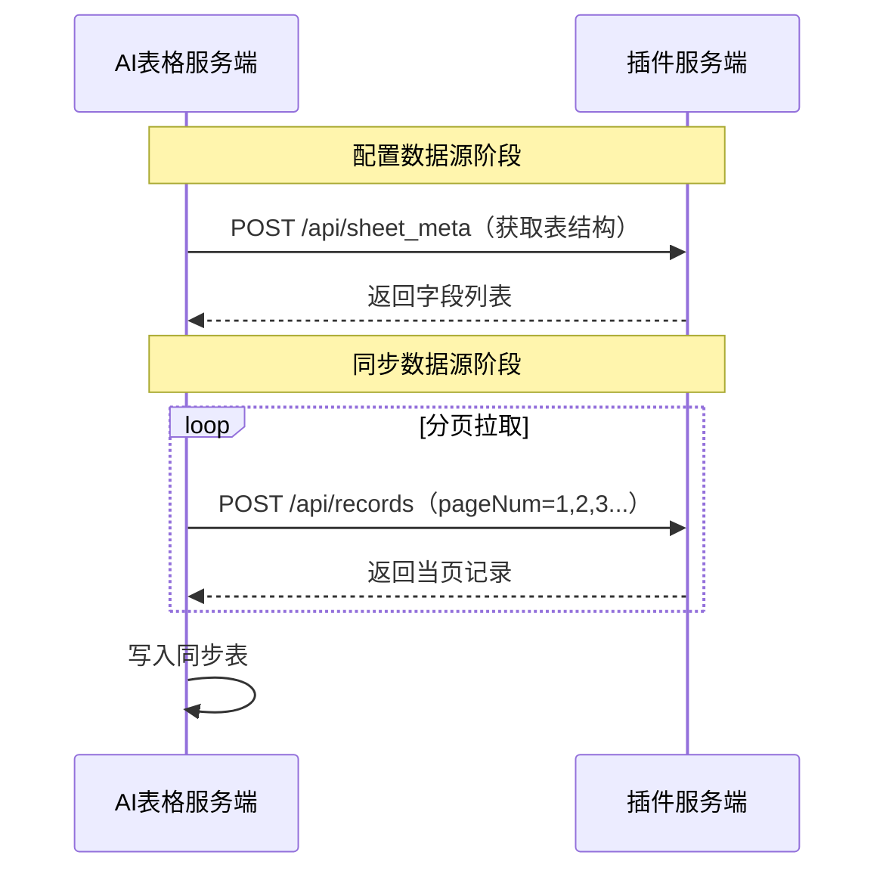

# 后端开发指南

本文档介绍 AI 表格数据源连接器插件后端的开发规范与实现要点。

## 快速开始（可用于快速验证接口）

推荐直接 fork 官方示例项目快速启动：
[dingdocs-notable/datasource-plugin-node-demo](https://github.com/dingdocs-notable/datasource-plugin-node-demo)

## 核心接口实现

开发者需要提供一个**公网可访问的服务地址**，并在该地址下实现以下接口（verify 为可选）：

### 接口概览

| 接口 | 方法 | 路径 | 超时时间 | 功能 |
|------|------|------|---------|------|
| 表结构接口 | `POST` | `/api/sheet_meta` | 10s | 返回数据源的字段结构 |
| 记录接口 | `POST` | `/api/records` | 20s | 返回数据源的分页记录 |
| 账号校验接口 | `POST` | `/api/verify` | 10s | 校验三方账号凭证合法性（**可选**，仅三方账号代管场景） |

三个接口的请求头均包含：
- `Ding-Docs-Timestamp`：请求时间戳
- `Ding-Docs-Signature`：请求签名（用于验证来源，见[签名验证](#签名验证signatureutil)）
- `Content-Type: application/json; charset=utf-8`

以下是一个数据同步流程图



### 表结构接口（/api/sheet_meta）

AI 表格服务端在用户完成前端配置后，首先会调用此接口查询表结构，根据返回的字段信息完成同步表的创建。

#### 请求体

```json
{
  "requestId": "",    // 单次同步任务的 requestId
  "params": "",       // JsonString，前端调用 saveConfigAndGoNext 保存的配置参数
  "context": {
    "unionId": "",       // 数据同步用户 id
    "corpId": "",        // AI 表格所属组织 id
    "credentials": {}   // 可选：账号凭证，仅当前端绑定了代管账号时存在，结构与创建账号时传入的 credentials 一致
  }
}
```

> `params` 是前端 `saveConfigAndGoNext` 保存的配置信息（如数据库地址、表名等），由开发者自定义格式。

#### 响应体

```json
{
  "code": 0,
  "msg": "",
  "data": {
    "sheetName": "users",
    "fields": [
      {
        "id": "fid_1",
        "name": "id",
        "type": "number",
        "isPrimary": true,
        "property": {
          "formatter": "INT"
        },
        "description": "主键"
      },
      {
        "id": "fid_2",
        "name": "username",
        "type": "text",
        "isPrimary": false,
        "property": {},
        "description": "用户名"
      }
    ]
  }
}
```

#### 响应体参数说明

> 字段 `type` 枚举值及对应 `property` 的完整定义，请参考 `references/interface/field-types.md`。

| 参数名 | 类型 | 是否必填 | 描述 |
|--------|------|---------|------|
| `code` | int | 是 | `0` 为正常，非 0 为异常。错误码：`10001` 参数错误 / `10002` 配置信息错误 / `10003` 权益不足 / `10004` 身份校验失败 / `10005` 三方系统异常 |
| `msg` | string | 否 | 具体错误信息 |
| `data.sheetName` | string | 是 | 同步表名称 |
| `data.fields` | array | 是 | 字段列表 |
| `data.fields[].id` | string | 是 | 字段唯一标识，**必须唯一且稳定**，推荐使用字段名，禁止使用随机数/UUID/时间戳 |
| `data.fields[].name` | string | 是 | 字段名称（同步表中显示的列名） |
| `data.fields[].isPrimary` | boolean | 是 | 是否主键字段，仅一列可为 `true` |
| `data.fields[].type` | string | 是 | 字段类型，枚举值见附录 |
| `data.fields[].property` | object | 否 | 字段类型属性，如数字格式、日期格式、选项列表等 |


### 记录接口（/api/records）

AI 表格服务端在触发数据同步时调用此接口，**分页拉取**所有行记录。

#### 请求体

```json
{
  "requestId": "",       // 单次同步任务的 requestId
  "maxResults": 300,     // 单次返回最大记录条数，默认 300
  "nextToken": "",       // 分页起始位置。首次调用不传，后续使用上次返回的 nextToken
  "params": "",          // JsonString，前端调用 saveConfigAndGoNext 保存的配置参数
  "context": {
    "unionId": "",          // 数据同步用户 id
    "corpId": "",           // AI 表格所属组织 id
    "credentials": {},      // 可选：账号凭证，仅当前端绑定了代管账号时存在
    "locale": "",           // 用户语言环境，如 zh-CN、en-US、ja-JP
    "docKey": "",           // 当前同步目标文档编码标识
    "sheetId": "",          // 当前同步目标工作表唯一标识
    "syncInstanceId": "",   // 同步实例 ID（与同步数据表唯一绑定）
    "taskId": "",           // 同步任务唯一 ID（每次触发同步生成）
    "fields": [             // 本次同步的字段信息列表（按需返回数据，减少传输量）
      { "id": "fid_1", "type": "text" },
      { "id": "fid_2", "type": "number" }
    ],
    "maxImportRowCount": 50000  // 当前允许同步的最大行数上限
  }
}
```

> **注意**：`context` 中的 `fields`、`syncInstanceId`、`taskId`、`maxImportRowCount` 为 records 接口专有字段，sheet_meta 接口不会传入。
> `context` 中的字段会随平台迭代新增，开发者应兼容未知字段（如使用 `@JsonIgnoreProperties(ignoreUnknown = true)`）。

#### `context.fields` 使用说明

当平台传入 `context.fields` 时，开发者可以：
1. **按需返回数据**：仅查询和返回 `fields` 中列出的字段，减少数据传输量
2. **直接获取字段类型**：无需重复调用 `sheet_meta` 或从数据推断类型，直接使用 `fields[].type` 进行数据转换

```java
// 示例：利用 context.fields 过滤返回字段
List<RecordsRequest.SyncField> syncFields = request.getContext().getFields();
if (syncFields != null && !syncFields.isEmpty()) {
    Set<String> requiredFieldIds = syncFields.stream()
        .map(RecordsRequest.SyncField::getId)
        .collect(Collectors.toSet());
    // 仅返回平台需要的字段数据
    record.getFields().keySet().retainAll(requiredFieldIds);
}
```

#### 响应体

```json
{
  "code": 0,
  "msg": "",
  "data": {
    "nextToken": "xxx",
    "hasMore": false,
    "total": 100,
    "records": [
      {
        "id": "1",
        "fields": {
          "fid_1": 1,
          "fid_2": "张三"
        }
      },
      {
        "id": "2",
        "fields": {
          "fid_1": 2,
          "fid_2": "李四"
        }
      }
    ]
  }
}
```

#### 响应体参数说明

| 参数名 | 类型 | 是否必填 | 描述 |
|--------|------|---------|------|
| `code` | int | 是 | 同表结构接口 |
| `data.nextToken` | string | 否 | 下一页的分页令牌，`hasMore` 为 `true` 时必须返回 |
| `data.hasMore` | bool | 是 | 是否还有更多数据 |
| `data.total` | int | 否 | 数据总条数，可选，用于计算同步进度 |
| `data.records[].id` | string | 是 | 行记录唯一标识，**必须稳定**，不随分页位置或时间变化 |
| `data.records[].fields` | map | 是 | 行数据，key 为字段 `id`，必须与 `sheet_meta` 返回的字段 `id` 完全一致 |

### 账号校验接口（/api/verify）

> **可选接口**，仅在插件使用了**三方账号代管**能力时可提供。未配置 `verifyEndpoint` 时，平台跳过校验环节。

当用户**创建关联账号**或**创建同步数据表**前，AI 表格服务端会调用此接口验证账号凭证的合法性。若返回 `valid: false`，创建流程将被中断，并向用户展示 `errorMessage`。

#### 触发时机

| 时机 | 说明 |
|------|------|
| 创建关联账号时 | 用户在前端提交账号凭证后立即触发，校验不通过则不保存账号 |
| 创建同步数据表前 | 配置数据源阶段，调用 `sheet_meta` 之前触发，校验不通过则中断配置流程 |

#### 请求体

```json
{
  "requestId": "",    // 单次请求的 requestId
  "context": {
    "unionId": "",       // 当前操作用户 id
    "corpId": "",        // AI 表格所属组织 id
    "credentials": {}   // 账号凭证，结构与创建账号时传入的 credentials 完全一致
  }
}
```

> 注意：与 `sheet_meta` 不同，此接口**不包含 `params` 字段**。

#### 响应体

```json
{
  "code": 0,
  "msg": "",
  "data": {
    "valid": true,
    "errorMessage": ""   // valid=false 时填写，将直接展示给用户
  }
}
```

#### 响应体参数说明

| 参数名 | 类型 | 是否必填 | 描述 |
|--------|------|---------|------|
| `code` | int | 是 | `0` 为正常，非 0 为系统异常 |
| `data.valid` | boolean | 是 | 凭证是否合法。`false` 时中断创建流程 |
| `data.errorMessage` | string | 否 | `valid: false` 时的错误提示，将展示给用户，建议说明原因 |

#### Java 示例代码

```java
@PostMapping("/api/verify")
public ApiResponse<VerifyResult> verify(@RequestBody VerifyRequest request) {
    Map<String, String> credentials = request.getContext().getCredentials();

    // 使用 credentials 调用三方系统验证账号合法性
    boolean isValid = thirdPartyClient.checkCredentials(
        credentials.get("username"),
        credentials.get("token")
    );

    VerifyResult result = new VerifyResult();
    result.setValid(isValid);
    if (!isValid) {
        result.setErrorMessage("账号或密码错误，请检查后重试");
    }
    return ApiResponse.success(result);
}
```

---

## 三方账号代管：context.credentials 字段

当前端在调用 `saveConfigAndGoNext` 时绑定了代管账号，两个接口的请求体 `context` 中将额外包含 `credentials` 字段，内容与账号创建时传入的 `credentials` 完全一致。

### 示例

前端创建账号时传入：
```json
{
  "username": "admin",
  "token": "tk_abc123"
}
```

后端接收到的请求体：
```json
{
  "requestId": "xxx",
  "params": "...",
  "context": {
    "unionId": "xxx",
    "corpId": "xxx",
    "credentials": {
      "username": "admin",
      "token": "tk_abc123"
    }
  }
}
```

### 使用建议

1. **判断 credentials 是否存在**：`credentials` 字段仅在绑定了账号时才会存在，开发者应判断非空后再使用
2. **字段结构由插件自定义**：`credentials` 的具体字段取决于前端创建账号时传入的 key-value，后端按需取用
3. **安全注意**：`credentials` 由钉钉一方加密存储和传输，后端应对其内容保密，不要记录到日志中

### Java 示例代码

```java
// 假设前端创建账号时使用 { "username": ..., "token": ... }
@Data
public class RequestContext {
    private String unionId;
    private String corpId;
    private Map<String, String> credentials; // 可为 null，如果前端未绑定账号
}

// 在 Service 中使用
public void fetchData(RequestContext context) {
    if (context.getCredentials() != null) {
        String username = context.getCredentials().get("username");
        String token = context.getCredentials().get("token");
        // 使用凭证连接三方系统…
    }
}
```

---

## 动态查询凭证 Token 解密

当插件配置面板调用 `account.getCredentialToken(accountId)` 获取 `credentialToken` 后，会将其传给插件服务端。插件服务端用在开放平台配置的 `encryptionKey` 解密 token，得到明文凭证后调用三方 API。

> 若插件未在开放平台配置 `encryptionKey`，`credentialToken` 为 Base64url 编码的明文凭证 JSON，直接 Base64url 解码即可。

### Java 解密示例

```java
public Map<String, String> decryptCredentialToken(String token, String encryptionKey) throws Exception {
    byte[] raw = Base64.getUrlDecoder().decode(token);
    ByteBuffer buf = ByteBuffer.wrap(raw);

    byte version = buf.get();
    if (version != 0x01) throw new IllegalArgumentException("unsupported token version");

    long expireAt = buf.getLong();
    if (System.currentTimeMillis() > expireAt) {
        throw new SecurityException("credentialToken expired");
    }

    byte[] iv = new byte[12];
    buf.get(iv);

    byte[] cipherWithTag = new byte[buf.remaining()];
    buf.get(cipherWithTag);

    // 派生 AES 密钥
    byte[] aesKey = Arrays.copyOf(
        MessageDigest.getInstance("SHA-256").digest(encryptionKey.getBytes(StandardCharsets.UTF_8)), 32);

    Cipher cipher = Cipher.getInstance("AES/GCM/NoPadding");
    cipher.init(Cipher.DECRYPT_MODE,
                new SecretKeySpec(aesKey, "AES"),
                new GCMParameterSpec(128, iv));
    // AAD 必须与加密时一致
    cipher.updateAAD(ByteBuffer.allocate(8).putLong(expireAt).array());

    byte[] plaintext = cipher.doFinal(cipherWithTag);
    return JSON.parseObject(new String(plaintext, StandardCharsets.UTF_8),
                            new TypeReference<Map<String, String>>() {});
}

// 使用示例：插件服务端接收前端传来的 token，解密后调用三方 API
@PostMapping("/api/tables")
public Map<String, Object> getTables(@RequestBody Map<String, String> body) throws Exception {
    String token = body.get("credentialToken");
    Map<String, String> credentials = decryptCredentialToken(token, ENCRYPTION_KEY);

    String apiKey = credentials.get("apiKey");  // key 与前端 create 时自定义的一致
    List<Map<String, String>> tables = thirdPartyClient.listTables(apiKey);
    return Map.of("tables", tables);
}
```

### Node.js 解密示例

```javascript
const crypto = require('crypto');

function decryptCredentialToken(token, encryptionKey) {
  const raw = Buffer.from(token, 'base64url');

  const version = raw[0];
  if (version !== 0x01) throw new Error('unsupported token version');

  const expireAt = raw.readBigInt64BE(1);
  if (Date.now() > Number(expireAt)) throw new Error('credentialToken expired');

  const iv = raw.slice(9, 21);              // 12 bytes
  const cipherWithTag = raw.slice(21);
  const ciphertext = cipherWithTag.slice(0, -16);
  const tag = cipherWithTag.slice(-16);

  // 派生 AES 密钥
  const aesKey = crypto.createHash('sha256').update(encryptionKey).digest().slice(0, 32);
  // AAD：expireAt 的 big-endian 8 字节
  const aad = raw.slice(1, 9);

  const decipher = crypto.createDecipheriv('aes-256-gcm', aesKey, iv);
  decipher.setAAD(aad);
  decipher.setAuthTag(tag);

  const plaintext = Buffer.concat([decipher.update(ciphertext), decipher.final()]);
  return JSON.parse(plaintext.toString('utf8'));
}
```

### 安全注意事项

1. **校验过期时间**：必须检查 `expireAt`，拒绝处理过期 token
2. **GCM 认证 tag 自动防篡改**：AES-GCM 模式会自动校验 tag，无需额外处理
3. **AAD 必须一致**：解密时传入的 AAD（`expireAt` 字节）必须与加密时一致，否则解密失败
4. **不要记录明文**：解密后的凭证不要输出到日志中

---

> **数据类型约束**：
> - 数字字段 → 返回数字（非字符串）
> - 日期字段 → 返回毫秒时间戳（非日期字符串）
> - 单选/多选 → 返回选项名称字符串

### 错误响应格式

```json
{
  "code": 10002,
  "msg": "配置信息错误：无法连接到数据库"
}
```

| 错误码 | 说明 |
|--------|------|
| `10001` | 参数错误 |
| `10002` | 配置信息错误 |
| `10003` | 权益不足 |
| `10004` | 身份校验失败 |
| `10005` | 三方系统异常，请稍后再试 |

## ⚠️ 关键开发规范（必读）

字段 ID、行数据 ID 和数据类型的规范是开发中**最容易出错**的部分，必须严格遵守。

详见 `references/interface/data-rules.md`。


## 自定义错误码与 Manifest 国际化配置

### 错误码规范

| 范围 | 类型 | 说明 |
|------|------|------|
| 0 | 成功 | 同步成功 |
| 10001~10005 | 系统内置（保留） | 平台定义的标准错误分类，开发者不可用于自定义业务错误 |
| 10006~19999 | 开发者自定义 | 用于表达插件特有的业务错误 |

### 系统内置错误码

| code | 语义 | 用户侧操作按钮 |
|------|------|------|
| 10001 | 参数错误 | [修改配置] |
| 10002 | 同步配置错误 | [修改配置] |
| 10003 | 用户无权益 | [联系客服] |
| 10004 | 认证失败（如 Token 过期） | [重试] [联系客服] |
| 10005 | 服务端异常 | [重试] [联系客服] |

> 自定义错误码（10006+）默认展示 [重试] 和 [联系客服] 按钮。

### 接口返回方式

在 `sheet_meta` 或 `records` 接口中，返回非 0 的 code 表示同步失败：

```java
return ApiResponse.error(10006, "数据库连接失败，请检查用户名和密码是否正确");
```

### Manifest errorMessages 配置（推荐）

在 `manifest.json` 中预配置错误码对应的国际化文案。平台优先使用 manifest 中的文案展示给用户：

```json
{
  "manifest": {
    "base": {
      "dataSource": {
        "errorMessages": {
          "10006": "${{err_10006}}",
          "10007": "${{err_10007}}"
        }
      }
    }
  },
  "i18nMap": {
    "zh-CN": {
      "err_10006": "数据库认证失败，请检查用户名和密码",
      "err_10007": "连接超时，请检查网络和IP白名单"
    },
    "en-US": {
      "err_10006": "Authentication failed. Check username and password.",
      "err_10007": "Connection timed out. Check network and IP whitelist."
    },
    "ja-JP": {
      "err_10006": "認証に失敗しました。ユーザー名とパスワードを確認してください。",
      "err_10007": "接続がタイムアウトしました。ネットワークとIPホワイトリストを確認してください。"
    }
  }
}
```

> **⚠️ 重要约束**：
> - i18nMap 的 key **禁止使用连字符 `-`，可以使用下划线 `_`替代**。平台使用 nunjucks 模板引擎渲染 `${{key}}`，连字符会被解析为减法运算导致输出 `NaN`。
> - 错误文案应**尽可能简短**（建议 ≤ 30 字中文），因为在弹窗中空间有限。
> - errorMessages 的 key 对应接口返回的 `code` 值（字符串形式），范围建议 10006~10099。

### 文案解析优先级

平台按以下优先级确定最终展示给用户的错误文案：

1. manifest `errorMessages[code]` 配置的国际化文案
2. 插件接口返回的 `msg` 字段
3. 系统内置 code 的默认文案（仅 10001~10005）
4. 平台默认错误提示

> **建议**：始终在接口返回中携带有意义的 `msg`，同时在 manifest 中配置国际化文案覆盖，确保多语言用户都能看到清晰的错误描述。

---

## 签名验证（SignatureUtil）

签名的作用是**确认接口来源为 AI 表格服务端**，防止其他方伪造请求。

### 算法说明

**算法**：HMAC-SHA256，结果 Base64 编码

**签名内容**：`body + timestamp`（请求体字符串与时间戳直接拼接）

**验证步骤**：

1. 插件上架时，双方约定一个 `signKey`
2. 从请求 Header 中获取 `Ding-Docs-Timestamp`（记为 `timestamp`）和 `Ding-Docs-Signature`（记为 `signature`）
3. 获取原始请求 Body 字符串（记为 `body`）
4. 将 `signKey`、`body`、`timestamp` 按规则加密得到 `signatureExpected`
5. 校验 `signature` 与 `signatureExpected` 是否一致
6. 将秒或毫秒时间戳统一为毫秒，拒绝与服务器当前时间相差超过 5 分钟的请求，防止签名请求被重放

比较签名时使用常量时间比较函数，不要把完整签名写入日志。

### Java 示例代码

```java
/**
 * 验证请求签名
 *
 * @param signKey 双方约定的密钥
 * @param body      原始请求体字符串
 * @param timestamp 请求时间戳（来自 Ding-Docs-Timestamp Header）
 * @param signature 请求签名（来自 Ding-Docs-Signature Header）
 * @return 签名是否匹配
 */
public static boolean hmacSha256Base64(String signKey, String body, long timestamp, String signature) {
    try {
        Mac sha256Hmac = Mac.getInstance("HmacSHA256");
        SecretKeySpec keySpec = new SecretKeySpec(signKey.getBytes(StandardCharsets.UTF_8), "HmacSHA256");
        sha256Hmac.init(keySpec);
        String content = body + timestamp;
        byte[] hash = sha256Hmac.doFinal(content.getBytes(StandardCharsets.UTF_8));
        String signatureExpected = Base64.getEncoder().encodeToString(hash);
        return signature.equals(signatureExpected);
    } catch (Exception e) {
        throw new RuntimeException("signature not match", e);
    }
}
```

### 开发环境关闭验证

你可以创建一个 `application.yml` 关闭签名验证，用于本地调试：
```yaml
plugin:
  sign-key: your-sign-key
  enable-signature-verification: false  # 开发时设为 false，生产必须为 true
```


## 本地调试（内网穿透）

后端服务需要**公网可访问**，AI 表格服务端才能调用你的接口。本地开发时，使用内网穿透工具将本地服务暴露到公网。

推荐使用 **Cloudflare Tunnel**（无需账号，一行命令），ngrok 为备选方案。

> ⚠️ **安全提示**：内网穿透会将本地服务暴露到公网，存在安全风险。请确保本地环境不含敏感数据，**仅在开发调试阶段使用**，生产环境请使用正式部署方案。

内网穿透详细使用方式见 `docs/debug-guide.md`。
