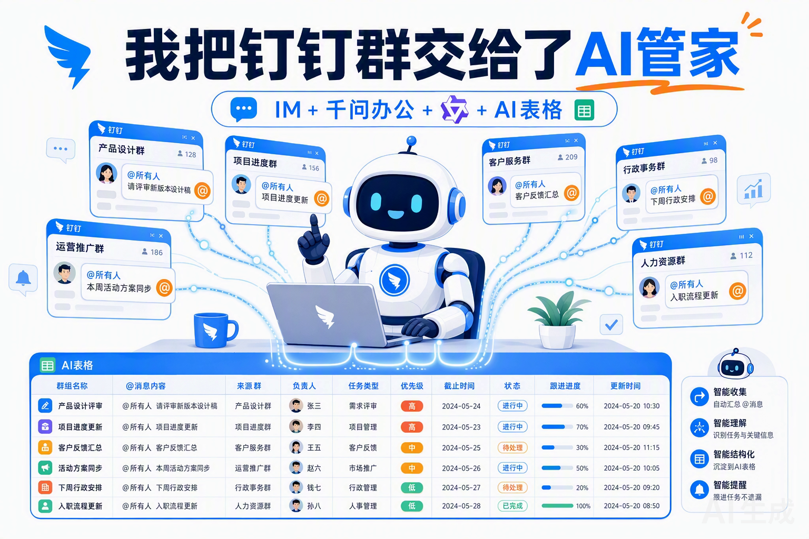
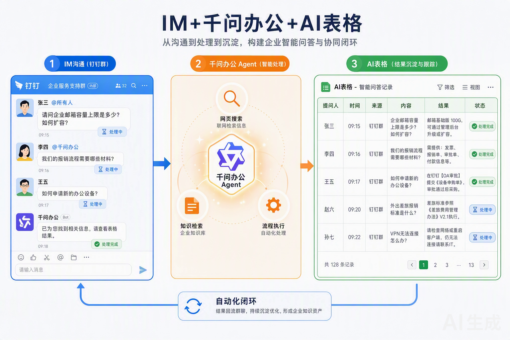
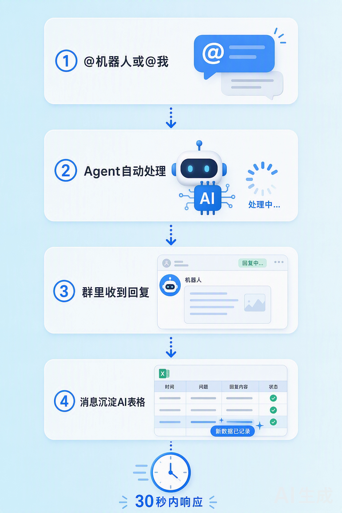

# AI 表格协同应答助手 · 让 IM、Agent 与 AI 表格协同响应你的钉钉消息

> IM 收消息 → 千问办公 Agent 处理 → AI 表格沉淀，三端协同、一表兜底。

## 起因：被群消息淹没的那天

做产品 & 技术的同学应该都懂：客群答疑、内部报障群、协同沟通群……每天几百条消息涌进来，其中大部分是重复问题。回吧，占掉半天时间；不回吧，用户觉得你高冷。

某天我盯着几个群发了会儿呆，突然想到：我有千问办公（一个能联网、能读文档、能执行操作的桌面 Agent），有 AI 表格（在线数据库），为什么不让它们自己协作起来？

于是花了一个下午，搭了这么一套东西——现在群里 @机器人或者 @我本人，30 秒内 AI 自动处理并回复，所有消息还会自动归档成一张可检索的问题表。

## 它是怎么跑起来的

整个链路就三步：

- **IM 收消息** → 钉钉群里有人 @机器人 或 @我 → 轮询程序捕捉到这条消息
- **千问办公 Agent 处理** → Agent 接手：联网查资料、读文档、查日志、执行操作，该干嘛干嘛
- **AI 表格沉淀** → 处理完的消息自动写入 AI 表格：提问人、时间、来源群、内容、处理结果、状态，一个字段不落

几个我觉得比较妙的设计：

1. **双身份回复，真假难辨**
   @机器人时，AI 用机器人身份回 Markdown 消息；@我本人花名时，AI 用我的身份发流式卡片——因为底层用的是我自己的钉钉认证，群里的人看到的就是「我」在回复，没人知道是数字分身。

2. **闲聊不打扰，正事才出手**
   AI 会先判断消息：纯寒暄、客套话直接静默忽略（不浪费额度）；有实际问题的才触发处理。消息上还会自动贴「处理中 → 处理完成」的状态标签，处理进度一目了然。

3. **消息变资产**
   以前群消息回完就沉底了。现在每条处理过的消息都进了 AI 表格，攒一段时间就是一份现成的问题库——哪个群问得多、什么类型的问题最常见、处理结果如何，筛选统计随取随用。而且表是自动建的：第一次用时自动创建「问题收集表」，之后直接复用，不会重复建表。

## 实际效果

部署之后我的体感：

- 群里常见问题基本不用我出手了，AI 回得又快又规范
- 我只需要处理 AI 拿不准、真正需要人来判断的事
- 周报想统计「这周处理了多少问题」，打开 AI 表格筛选一下就有
- 有一次同事 @我问了个问题，我半天后翻记录才发现是「我」（数字分身）已经回过了

*一点碎碎念：这套东西本质上是把 IM 的即时性、Agent 的处理能力、AI 表格的结构化能力串成了一条流水线。IM 是入口，Agent 是大脑，AI 表格是记忆。三个都是现成能力，打通之后 1+1+1 远大于 3。*

